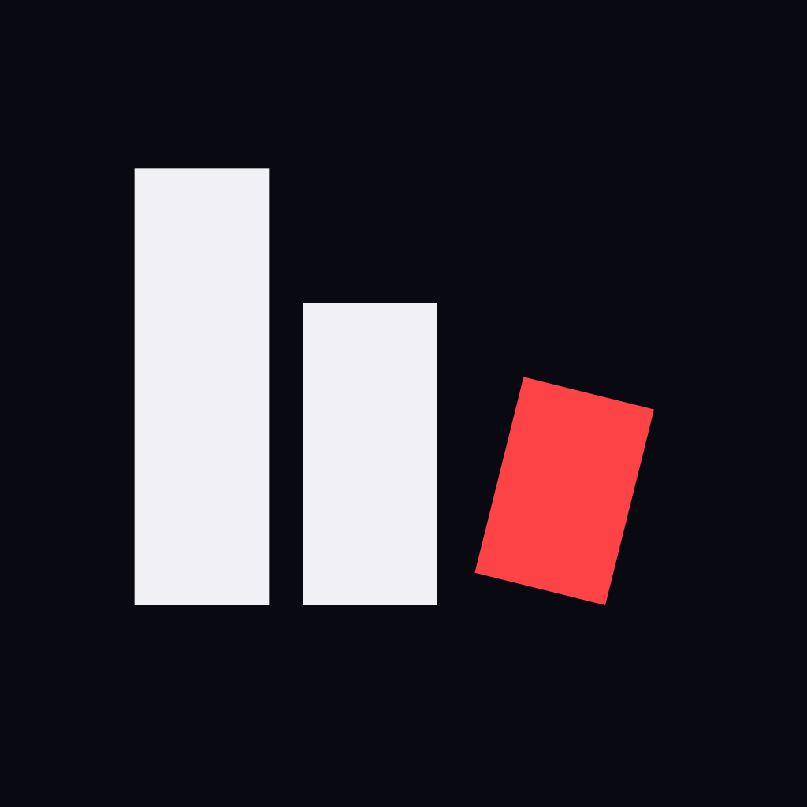
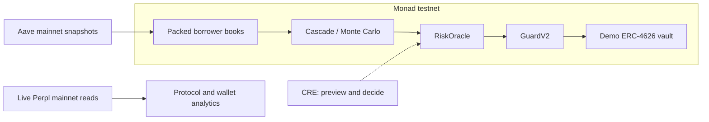

<p align="center">
  
</p>

<h1 align="center">Kaskad</h1>

<p align="center"><strong>When collateral falls, can liquidators actually clear the debt?</strong></p>
<p align="center">On-chain liquidation stress tests and verifiable risk controls on Monad.</p>
<p align="center">
  <a href="https://kaskad42.vercel.app">Try Kaskad</a> ·
  <a href="https://youtu.be/OZ5R2g6rRJo">Watch the demo</a> ·
  <a href="docs/TECHNICAL-REFERENCE.md#deployments-and-proof-transactions">Inspect the proofs</a>
</p>

**Monad Metropolis · Track 1: Onchain Finance & Trading**

**Submitted and finalized on 13 October 2026 · Ready for judging**

Built by **Marwa İpek** and **Rıfat Buğra Yavaşcan**, representing **PRU Blockchain Community**. [MIT licensed](LICENSE).

[Videos](#watch-the-submission) · [Try it](#try-the-app) · [Architecture](#architecture) · [Why Monad](#why-monad) · [Integrations](#integrations) · [Quick start](#run-locally) · [Documentation](#documentation)

## The problem

A lending position can cross its liquidation threshold while market liquidity is too thin to clear it profitably. Collateral ratios alone do not explain the resulting bottleneck.

Kaskad simulates the full cascade: a price shock triggers liquidations, collateral sales move the pool price, and those moves can trigger further liquidations. Real Aave borrower books become reproducible on-chain stress tests. The results can also feed a risk oracle, a circuit breaker, and an ERC-4626 demo vault.

| Recorded evidence | What it shows |
|---|---|
| **$111M stuck after a −3% shock** | In the 57-position syrupUSDC book with $123.7M debt, instant-sale liquidators cannot profitably clear most exposed debt through the modeled pool. |
| **$8.8M additional hidden bad debt at −10%** | Valuing remaining collateral at simulated pool spot reveals shortfall beyond the external-oracle valuation. |
| **10,000 positions in one testnet transaction** | The recorded scale proof uses 17.7M engine gas; the full receipt reports 21.7M gas. |

These are **modeled outcomes on recorded data**, not current market losses. Stuck debt, oracle bad debt, and additional hidden bad debt are distinct measures and must not be added together. [Inputs, definitions, and assumptions →](docs/TECHNICAL-REFERENCE.md#what-the-model-finds)

## Watch the submission

All four videos are published and linked in the finalized Metropolis entry.

| Video | Duration | What to look for |
|---|---:|---|
| **[Technical demo](https://youtu.be/OZ5R2g6rRJo)** | **2:48** | Cascade previews, hidden bad debt, borrower exposure, risk controls, Perpl, replay, and the encrypted watchlist. |
| [Pitch](https://youtu.be/dxSGycde_b0) | 1:51 | The team, liquidation-liquidity problem, intended users, and proposed route to market. |
| [Chainlink CRE](https://youtu.be/BgLYiIOVSEA) | 1:32 | A successful CLI simulation and separate recorded testnet broadcast evidence. |
| [Perpl Risk Tool](https://youtu.be/styCT_l5ayU) | 1:45 | Live protocol stress analytics and public-wallet positions and shock exposure. |

The [submission archive](docs/submission/README.md) records final status, media, logo, and validation. [Narration and storyboard sources](docs/video/README.md) are preserved as production history; their scene timings are planning targets, not timestamps for the final edits.

## Try the app

**A short reviewer tour:** open the [console](https://kaskad42.vercel.app/app), preview syrupUSDC at **−3%**, then compare **−10%** and its hidden bad debt. Open **Who is exposed**, inspect the [Guard pipeline](https://kaskad42.vercel.app/guard), and compare the [live Perpl view](https://kaskad42.vercel.app/perps).

| Experience | Open it |
|---|---|
| Risk map: 11 eligible books × five shocks | [Home](https://kaskad42.vercel.app) |
| Cascade waves, Monte Carlo, borrower exposure, and signed proofs | [Console](https://kaskad42.vercel.app/app) |
| RiskOracle → GuardV2 → demo vault | [Guard](https://kaskad42.vercel.app/guard) |
| Historical Aave replay: 10–11 October 2025 | [Replay](https://kaskad42.vercel.app/replay) |
| Perpl liquidation levels, depth, backstop, and wallet risk | [Perps](https://kaskad42.vercel.app/perps) |
| Aave address lookup and passkey-encrypted watchlist | [Wallet](https://kaskad42.vercel.app/wallet) |
| Model explanation and recorded transactions | [How it works](https://kaskad42.vercel.app/how-it-works) |

Previews need no sign-in. **Prove on chain** is a separate signed action using a Mera passkey and sponsored testnet MON. Passkeys are hostname-bound and require WebAuthn PRF support. The UI is available in English and [Turkish](https://kaskad42.vercel.app/tr).

## Architecture



HyperSync or the resumable RPC fallback discovers Aave borrowers; block-pinned reads reconstruct positions. Each position occupies one 32-byte storage slot, and a heap orders liquidation prices. The model combines Aave-style liquidations, constant-product pool impact, oracle behavior, and arbitrage recovery.

The main console uses Kaskad/KaskadMC; the RiskOracle pipeline uses KaskadMCv3. CRE reports reach the risk contracts through a forwarder and receiver. [Full architecture and contract roles →](docs/TECHNICAL-REFERENCE.md#architecture)

> **Network and execution scope:** Aave books are recorded Monad mainnet/Ethereum snapshots. Simulation transactions, proofs, guards, and vault actions use **Monad testnet (10143)** and demo assets. Perpl analytics read live mainnet data. CRE evidence comes from CLI simulations, including recorded broadcasts through a mock forwarder; a continuous production CRE workflow is future work.

## Why Monad

Packed, consecutive position slots let the engine benefit from Monad's storage locality. The recorded Blitz baseline demonstrates the difference under the documented gas assumptions:

| Workload | Monad testnet | Local Ethereum gas-accounting comparison |
|---|---:|---:|
| 10,000-position cascade | **17.7M engine gas** | 42.3M gas |
| 5,000-position cascade | **9.4M engine gas** | 20.5M gas |
| Monte Carlo preview capacity, external / pool oracle | **213 / 57 scenarios** | 114 / 34 scenarios |

These are historical baseline measurements, not fresh KaskadMCv3 results. Engine gas differs from receipt gas, and preview capacity differs from a signed proof. [Benchmark methodology and limits →](docs/TECHNICAL-REFERENCE.md#why-monad)

## Integrations

| Integration | What we built | Evidence |
|---|---|---|
| **Envio** | HyperSync borrower discovery with block-pinned position reconstruction and a resumable RPC fallback. | [Data pipeline](scripts/src/fetch-positions.ts) |
| **Chainlink CRE** | Cron/book-event decisions to publish risk, refresh guards, and rebalance the demo vault. | [Workflow and run logs](cre/README.md) · [Video](https://youtu.be/BgLYiIOVSEA) |
| **Alchemy** | Server-side Monad RPC infrastructure for mainnet reads, testnet previews, and sponsored proofs. | [RPC route](web/app/api/rpc/route.ts) |
| **Perpl** | Protocol liquidation/backstop analytics and public-wallet liquidation-threshold exposure. | [Live panel](https://kaskad42.vercel.app/perps) · [Video](https://youtu.be/styCT_l5ayU) |
| **Nansen** | Standard borrower labels in **Who is exposed**, with shared caching and request limits. Unlabelled addresses remain unidentified. | [Labels integration](web/app/api/labels/labels.ts) |
| **Mera UX + PRF** | Passkey signing, sponsored testnet gas, and separately derived keys for an encrypted persistent watchlist. | [Mera](web/lib/kaskad/mera.ts) · [Key derivation](web/lib/kaskad/passkey-keys.ts) |

[Integration coverage, privacy, caching, and model assumptions →](docs/TECHNICAL-REFERENCE.md#integrations)

## Deployments and proof transactions

All proofs below are on **Monad testnet**. They record the result at execution; current stored reports may differ.

| Proof | Recorded result |
|---|---|
| [syrupUSDC −3%, external oracle](https://testnet.monadscan.com/tx/0xc80dfd34835edcba1028b76945f4793598cf3b27bee470e79cffdd75b8a53a99) | $0 oracle bad debt; $111M stuck debt. |
| [10,000-position cascade](https://testnet.monadscan.com/tx/0x661facb56395f553be94399d004f0ca75834cc2f5037f54d37adff832d6d185c) | 17,736,204 engine gas; 21,725,444 receipt gas. |
| [RiskOracle publication](https://testnet.monadscan.com/tx/0x59594b314e45d202a2182dacc29d813ce9649d07a146e3e30687dd9cdba3a8f9) | syrupUSDC recommendation moves from 90% to 85% LTV. |
| [CRE broadcast simulation](https://testnet.monadscan.com/tx/0x07161a3ab2b540af3e1177e40161027893e800a9551df37bb019f8e38f89c5b5) | Receiver processes the risk pipeline through the mock forwarder. |

The [complete ledger](docs/TECHNICAL-REFERENCE.md#deployments-and-proof-transactions) preserves **12 contract addresses and 11 proof transactions**, including Monte Carlo, GuardV2, vault rebalance, and CRE book-event runs.

## Run locally

Use **Node.js 24**. Foundry is needed for contracts; Bun and the CRE CLI are needed for workflow development.

```bash
git clone --recurse-submodules https://github.com/mryavascann/kaskad.git
cd kaskad
npm --prefix web ci
# Configure web/.env.local using the development guide.
npm --prefix web run dev
```

Open [localhost:3000](http://localhost:3000). Existing deployed contracts already contain books. [Environment variables, data preparation, tests, and CRE simulation →](docs/DEVELOPMENT.md)

## Limits and roadmap

The hackathon submission is **finalized**. The demo remains a prototype with explicit boundaries: recorded Aave snapshots, a single-dominant-collateral model, assumed pool depth, immediate-sale liquidators, and testnet mock markets. Monte Carlo frequencies are not calibrated loss probabilities. The historical replay uses liquidity measured after the event. [Full model limits →](docs/TECHNICAL-REFERENCE.md#limits-and-roadmap)

Future development includes a continuous Envio HyperIndex/keeper pipeline, a deployed production CRE workflow, and shared rate limiting for remaining per-instance routes. These are follow-on engineering tasks, not incomplete submission fields.

The deployed demo has cloud site/sponsor/Nansen monitoring configured through **3 November 2026**, independent of a local computer. It sends incident/recovery emails and performs no top-ups or chain writes. [Monitoring status and runbook →](docs/DEVELOPMENT.md#cloud-health-monitoring)

## Documentation

| Start here | Contents |
|---|---|
| [Documentation index](docs/README.md) | Navigation across the finalized project archive. |
| [Submission record](docs/submission/README.md) | Completion status, four final videos, logo, and validation. |
| [Technical reference](docs/TECHNICAL-REFERENCE.md) | Findings, architecture, integrations, historical replay, benchmark provenance, proof ledger, and PR history. |
| [Development and operations](docs/DEVELOPMENT.md) | Local setup, tests, data scripts, RPC/sponsor protection, budget, and monitoring. |
| [Video production archive](docs/video/README.md) | Original English narrations and Turkish recording notes; completed production history. |

The [build history](docs/TECHNICAL-REFERENCE.md#build-history) distinguishes the **26 September 2026 Monad Blitz Istanbul baseline** from subsequent Metropolis additions. Source lives in [`contracts/`](contracts), [`web/`](web), [`scripts/`](scripts), and [`cre/`](cre). The [earlier Turkish README](README.tr.md) is retained as a historical archive.

**Marwa İpek · Rıfat Buğra Yavaşcan · PRU Blockchain Community** · [MIT License](LICENSE)
