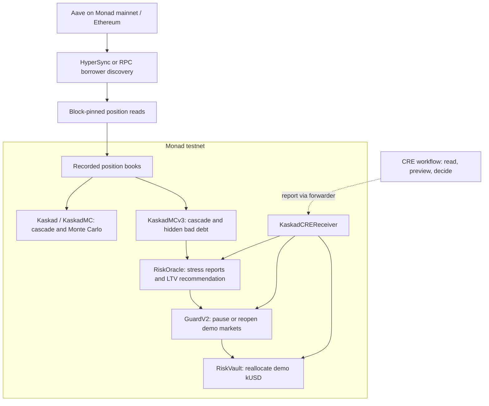

# ▼ Kaskad

**On-chain liquidation stress tests for lending markets, built on Monad.**

[Live demo](https://kaskad42.vercel.app) · [Technical demo · 2:48](https://youtu.be/OZ5R2g6rRJo) · [Pitch · 1:51](https://youtu.be/dxSGycde_b0) · [On-chain proofs](#deployments-and-proof-transactions)

**Monad Metropolis · Track 1: Onchain Finance & Trading**

Marwa İpek & Rıfat Buğra Yavaşcan · PRU Blockchain Community · [MIT](LICENSE)

What happens to a lending market when collateral falls 3% and liquidators cannot sell it profitably? Kaskad models the chain reaction: liquidations, collateral sales, price impact, and further liquidations. It packs real Aave borrower positions into contract storage and runs the cascade on Monad, with free previews and signed testnet proofs.

In the recorded syrupUSDC book, a **3% shock leaves $111M of debt below the liquidation threshold but unable to exit profitably through the modeled pool**. Kaskad makes that liquidity bottleneck visible, then demonstrates how a risk feed can pause a demo market and move an ERC-4626 vault away from it.

> **Demo scope:** Aave data comes from recorded Monad mainnet and Ethereum snapshots. Simulation transactions, risk controls, and the demo vault run on **Monad testnet (chain ID 10143)**. Perpl analytics separately read live mainnet data. Kaskad does not control Aave or move real Aave deposits.

The Metropolis submission and all four demo videos were completed on **13 October 2026**. The deployed demo has cloud health monitoring configured through **3 November 2026**; see [operations](#operations).

[Try the app](#try-the-app) · [Findings](#what-the-model-finds) · [Architecture](#architecture) · [Integrations](#integrations) · [Why Monad](#why-monad) · [Run locally](#run-locally) · [Limits and roadmap](#limits-and-roadmap)

## Try the app

1. Open the [simulation console](https://kaskad42.vercel.app/app), select a recorded book, and preview a price shock. No sign-in is needed.
2. Inspect liquidation waves, stuck debt, and hidden bad debt. Open **Who is exposed** for borrower addresses and available Nansen labels, or compare Monte Carlo scenarios.
3. To record a result, choose **Prove on chain**, sign in with a Mera passkey, and confirm the testnet action. The sponsor supplies testnet MON for gas.

| Page | What you can explore |
|---|---|
| [Home](https://kaskad42.vercel.app) | The reference finding and a risk map of 11 eligible books × five shocks. |
| [Console](https://kaskad42.vercel.app/app) | Cascade simulation, borrower exposure, Monte Carlo, and signed proofs. |
| [Guard](https://kaskad42.vercel.app/guard) | Four stress reports, pause/LTV decisions, and demo vault allocation. Publish, refresh, and rebalance are separate actions with cost estimates. |
| [Historical replay](https://kaskad42.vercel.app/replay) | Model results versus actual Aave liquidations during the 10–11 October 2025 ETH drawdown. |
| [Perps](https://kaskad42.vercel.app/perps) | Live Perpl liquidation levels, order-book absorption, backstop exposure, and public-wallet risk. |
| [Wallet](https://kaskad42.vercel.app/wallet) | Aave address exposure and a passkey-encrypted watchlist. |
| [How it works](https://kaskad42.vercel.app/how-it-works) | Model explanations and transaction evidence. |

The app is available in English at the root and in Turkish at [`/tr`](https://kaskad42.vercel.app/tr). Passkeys are hostname-bound and require WebAuthn PRF support; the user's signing key stays in the browser session.

**Integration videos:** [Chainlink CRE · 1:32](https://youtu.be/BgLYiIOVSEA) · [Perpl risk tools · 1:45](https://youtu.be/styCT_l5ayU).

## What the model finds

The reference Monad Aave snapshot is pinned to **mainnet block 108,133,182**: approximately **$531.0M supplied**, **$238.8M borrowed**, and **255 borrowers with debt**. Total collateral held by those borrowers is a separate figure: **$268.6M**. Source metadata and per-asset depth assumptions are recorded in [`deployment.json`](web/lib/kaskad/deployment.json).

The reference syrupUSDC book contains **57 positions and $123.7M of debt**. With 20 simulated blocks, up to three liquidation waves per block, and the external-price oracle:

| Collateral shock | Bad debt at oracle price | Debt stuck below the liquidation threshold | Additional hidden bad debt at pool spot |
|---|---:|---:|---:|
| −3% | $0 | $111.0M | ~$0.3M |
| −10% | ~$17.7K | $96.8M | $8.8M |
| −20% | $13.3M | ~$0.1M | $8.3M |

- **Stuck debt** is debt below the liquidation threshold whose collateral still covers the debt at the oracle price, but which an instant-sale liquidator cannot profitably clear in the model.
- **Bad debt** is the remaining shortfall when collateral is worth less than debt at the oracle price.
- **Hidden bad debt** is the additional shortfall when the remaining collateral is valued at the simulated pool spot price. It can overlap with positions counted as stuck; the three columns are not additive.

The recorded syrupUSDC DEX depth is about **$7.04M**. In the −3% scenario, liquidators repay only about **$134K** before further sales stop being profitable. Switching to the explicitly labeled worst case, where the oracle follows the pool, produces **$115.9M of bad debt** under the same initial shock. The snapshot's actual syrupUSDC oracle follows an exchange rate rather than the DEX spot price.

The risk map reads each book once and runs the engine's TypeScript replay for five shocks. It displays only after the reference syrupUSDC −3% cell agrees with an on-chain preview for stuck debt and bad debt to within $1; individual unreadable books may be omitted. This is a consistency check on one cell, not a separate proof transaction for every cell. See [`risk-map.ts`](web/lib/chain/risk-map.ts), [`replay.ts`](web/lib/chain/replay.ts), and their tests.

## Architecture



- **Efficient books:** each position occupies one 32-byte slot. A heap orders liquidation prices so each wave avoids rescanning every borrower.
- **Cascade mechanics:** the engine applies Aave-style close factors and liquidation bonuses, sells collateral into a virtual constant-product pool, and stops an instant-sale liquidator at break-even.
- **Recovery and oracle behavior:** KaskadMC models arbitrage between steps. External-price and pool-following oracle modes expose different feedback effects.
- **Contract-consumable risk:** `RiskOracle.publish(asset)` evaluates −1%, −3%, −10%, and −20% shocks and adjusts its recommended LTV by a bounded step. `GuardV2.refresh()` and `RiskVault.rebalance()` apply the result to mock markets and demo funds.
- **CRE orchestration:** cron or book events trigger a preview and decision. The receiver attempts publish, refresh, and rebalance in order; a failed step is logged without reverting the entire report.

The main console uses Kaskad/KaskadMC; the risk-feed pipeline uses KaskadMCv3. Anyone can trigger the public risk actions, while configuration and book loading remain owner-controlled.

**CRE evidence is scoped to CLI simulations.** Recorded end-to-end runs use `cre workflow simulate --broadcast` with a **MockKeystoneForwarder on Monad testnet**. A continuously deployed CRE workflow remains future work. The separate cloud health monitor does not run CRE or publish risk reports. See the [CRE guide and recorded runs](cre/README.md).

## Integrations

| Integration | Role in Kaskad | Implementation / evidence |
|---|---|---|
| **Envio** | HyperSync discovers Aave borrowers before block-pinned RPC/Multicall position reads. A resumable RPC fallback is also available. | [HyperSync client](scripts/src/lib/hypersync.ts), [data fetcher](scripts/src/fetch-positions.ts). Continuous HyperIndex/keeper operation is future work. |
| **Chainlink CRE** | Decides when to publish risk, refresh the guard, and rebalance the vault. | [Workflow](cre/kaskad-risk/workflow.ts), [decision logic](cre/kaskad-risk/decide.ts), [receiver](contracts/src/KaskadCREReceiver.sol), [broadcast logs](cre/runs). |
| **Alchemy** | Server-configured Monad RPC endpoints support position reads, the testnet proxy, and sponsored transactions. | [Chain clients](scripts/src/lib/chain.ts), [position API](web/app/api/position/route.ts), [RPC API](web/app/api/rpc/route.ts), [sponsor API](web/app/api/fund/route.ts). |
| **Perpl** | Live protocol and wallet analytics: liquidation thresholds, order-book absorption, backstop and insurance stress. | [Protocol reader](web/lib/kaskad/perpl.ts), [protocol model](web/lib/chain/perpl-model.ts), [wallet reader](web/lib/kaskad/perpl-wallet.ts), [wallet model](web/lib/chain/perpl-wallet-risk.ts). Analytics/Risk Tool scope; no hedge bot. |
| **Mera UX** | Passkeys provide the production account layer; sponsored testnet gas supports browser-signed proofs. | [Mera integration](web/lib/kaskad/mera.ts), [signer mode](web/lib/chain/signer-mode.ts), [passkey gate](web/views/shared/tx/passkey-gate.tsx). |
| **Mera PRF** | One passkey derives separate encryption, storage-identity, and write-authorization keys for the private watchlist. | [Key derivation](web/lib/kaskad/passkey-keys.ts), [watchlist API](web/app/api/watchlist/route.ts). |
| **Nansen** | Standard address labels add context to recorded borrowers and their simulated exposure. | [Exposure matching](web/lib/chain/exposure.ts), [labels API](web/app/api/labels/route.ts). Uncached lookups require API credits. |

<details>
<summary>Perpl: data coverage and risk assumptions</summary>

The protocol panel combines mainnet contract reads with the public L2 order book. Its **5% execution band is an assumption**; absorption and insurance calculations are stress scenarios, not guaranteed future fills or backstop capacity.

Wallet lookup requires only a public address, with no connection or signature. The account, positions, marks, and maintenance parameters are read at **one mainnet block** using the account bitmap and ABI from the [official Perpl SDK](https://github.com/PerplFoundation/dex-sdk/tree/01b9910761755b0a0d9c710c1ede62ab937daa7d/crates/sdk). Coverage includes BTC, ETH, SOL, MON, HYPE, and ZEC; other active markets produce a partial-coverage warning.

The wallet model uses isolated collateral and current funding. Free account balance is not added to position margin. The ±5%, ±10%, and ±20% scenarios report the **current notional of positions crossing liquidation thresholds**, not losses or executable proceeds. The same signed price move applies to every supported market; future funding, fees, account actions, and execution are excluded.

Views refresh every 10 seconds while visible, with an 8-second server cache. Failed wallet refreshes retain the last successful result and its block/time with a warning. Wallet requests are limited to 30/minute per server instance. Submitted addresses reach the server and RPC provider; they are not saved in browser storage.

</details>

<details>
<summary>Watchlist: encryption and verified persistence</summary>

Distinct HKDF labels derive an AES-256-GCM encryption key, an opaque storage ID, and a write token from the passkey's PRF output. Addresses and labels are encrypted in the browser. The storage endpoint keeps ciphertext, an opaque ID, and a write-token hash; it does not receive the plaintext list. Explicit address-risk queries still send the queried address to `/api/position`.

**Verified in production on 13 October 2026:** save a public sample address and label, change its threshold from 5% to 7%, fully reload, and sign in again with the same passkey. The label and 7% threshold were restored and the address-risk query succeeded, without a blockchain transaction.

</details>

<details>
<summary>Nansen: matching, caching, and credit protection</summary>

**Who is exposed** matches recorded borrower addresses to an independently checked simulation result. Ambiguous identical packed positions remain unidentified; calibrated books do not receive borrower identities.

Lookups use the [standard address-label endpoint](https://docs.nansen.ai/api/profiler/address-labels) for at most the largest 60 borrowers per book and the first 100 labels per address. Premium Smart Money labels are excluded. No label request is made until the tab is opened.

A seven-day shared cache, per-address locks, and global limits of 60 upstream calls/minute and 600/24-hour window bound requests across visitors. Page requests are limited to 20/minute per client. Cache/quota failures block upstream calls. These limits cap requests, not monetary spending; [provider credits](https://docs.nansen.ai/getting-started/credits) still apply.

Invalid keys, exhausted credits, throttling, and service failures have distinct safe errors. Failed requests are never cached as empty results. Production checks on 13 October 2026 covered all 57 syrupUSDC borrowers; no standard labels were returned, so the UI correctly retained their addresses as unlabelled.

</details>

## Why Monad

The engine's data layout makes storage locality useful: one packed 32-byte position per slot, in consecutive book slots. Under [MIP-8](https://github.com/monad-crypto/MIPs/blob/main/MIPs/MIP-8.md), a full 128-slot page amortizes to **162.5 gas per read** (`100 + 8,000 / 128`), compared with **2,100 gas per cold slot read** in the Ethereum comparison. Memory pricing and the transaction gas budget also affect how many positions or scenarios fit in one call.

These are the **recorded Blitz baseline benchmarks**, preserved from the [previous README](README.tr.md). Monad runs used testnet; the Ethereum numbers were recorded from local execution of the same contract/book under Ethereum gas accounting, not Ethereum transactions. They are not new KaskadMCv3 benchmarks.

| Workload | Monad testnet | Ethereum comparison recorded at baseline |
|---|---:|---:|
| 10,000-position cascade | **17.7M engine gas**, ~1.6 MB memory; [proof transaction](https://testnet.monadscan.com/tx/0x661facb56395f553be94399d004f0ca75834cc2f5037f54d37adff832d6d185c) | 42.3M gas, ~2.52× the 16,777,216 transaction cap |
| 5,000-position cascade | 9.4M engine gas | 20.5M gas, ~1.22× that cap |
| Monte Carlo preview capacity, 57-position book, external / pool-following oracle | 213 / 57 scenarios | 114 / 34 scenarios |
| Submission to receipt, four recorded `eth_sendRawTransactionSync` calls | Mean 336 ms | Not measured |

The comparison uses a **30M Monad transaction budget** and the [EIP-7825](https://eips.ethereum.org/EIPS/eip-7825) Ethereum cap. The scale proof's event records **17,736,204 engine gas** and **1,628,672 bytes of memory**; its receipt reports **21,725,444 gas**. Engine gas and transaction-level gas are different measurements. Preview capacity is also distinct from a completed proof transaction: the recorded Monte Carlo proofs below contain **208 and 56 paths**, respectively. Receipt latency is an observation from those calls, not a finality guarantee.

The console's Ethereum gauge is a **rough estimate**, implemented in [`limits.ts`](web/lib/chain/limits.ts), rather than a fresh Ethereum benchmark. Local benchmark code is in [`GasBench.t.sol`](contracts/test/GasBench.t.sol) and [`Profile.t.sol`](contracts/test/Profile.t.sol); the historical measurement script is [`measure-all.ts`](scripts/src/measure-all.ts). That script sends transactions and spends testnet MON.

## Historical replay: 10 October 2025

The [replay page](https://kaskad42.vercel.app/replay) uses the TypeScript engine mirror on an archived **4,640-position WETH-dominant Aave V3 Ethereum book**, with **$1.78B debt** at block **23,549,825**. The Chainlink ETH/USD price fell from about $4,010.36 to $3,456.70 (**−13.81%**).

| Comparison for borrowers in that book | Kaskad replay | Observed Aave liquidations |
|---|---:|---:|
| Debt liquidated | $48.3M | $26.9M |
| Distinct positions | 283 | 158 |

The replay assumes borrowers do not react. Subsequent chain reads identified **121 predicted positions that repaid debt or added collateral**; removing their predicted volume gives about **$24.5M**, approximately 9% below the observed $26.9M. This is an **after-the-fact adjustment**, not the unadjusted predictive accuracy. Other differences include unexecuted liquidations and collateral outside the single-asset model.

Pool depth was measured in **2026**, not at the 2025 event, and is explicitly an assumption. The replay is an off-chain historical analysis, not a testnet proof transaction. Sources: [`scripts/src/replay`](scripts/src/replay), [recorded comparison](scripts/data/oct10-replay.json), and [archived book](scripts/data/oct10-weth.json).

## Deployments and proof transactions

All addresses and transactions in this section are on **Monad testnet**. Deployment manifests: [original engine](contracts/deployments/testnet.json), [risk pipeline](contracts/deployments/risk-testnet.json), and [CRE receiver](contracts/deployments/cre-testnet.json).

<details>
<summary>Deployed contract addresses</summary>

| Contract | Address |
|---|---|
| Kaskad — book and cascade engine | [`0xdC2D3A2F4cffBf6a0d7945f6505399e2e474b661`](https://testnet.monadscan.com/address/0xdC2D3A2F4cffBf6a0d7945f6505399e2e474b661) |
| KaskadMC — recovery and Monte Carlo | [`0x94f27456bBAfe2a8A69ADE8D4C98eB958abB1E6d`](https://testnet.monadscan.com/address/0x94f27456bBAfe2a8A69ADE8D4C98eB958abB1E6d) |
| Guard — original demo | [`0xc39996831d3759CD4E9fB25005B400CA6a22871e`](https://testnet.monadscan.com/address/0xc39996831d3759CD4E9fB25005B400CA6a22871e) |
| KaskadMCv3 — on-chain hidden bad debt | [`0x389dD6251Fdc2f8D108fdbeC415d0AB517Ad3690`](https://testnet.monadscan.com/address/0x389dD6251Fdc2f8D108fdbeC415d0AB517Ad3690) |
| RiskOracle | [`0x0275C5b49f48D4ec9aE85D50785D160aaA1161e5`](https://testnet.monadscan.com/address/0x0275C5b49f48D4ec9aE85D50785D160aaA1161e5) |
| GuardV2 | [`0x874d38464c5845950c8693C35034E53279C2DAfc`](https://testnet.monadscan.com/address/0x874d38464c5845950c8693C35034E53279C2DAfc) |
| RiskVault — ERC-4626 demo | [`0x2aEa83Fc7F9834af61F7BbbBaF03707A6472a8C4`](https://testnet.monadscan.com/address/0x2aEa83Fc7F9834af61F7BbbBaF03707A6472a8C4) |
| MockUSD — demo kUSD | [`0x211Ed739699eAdfeA64AB08f7284F3aAE4467714`](https://testnet.monadscan.com/address/0x211Ed739699eAdfeA64AB08f7284F3aAE4467714) |
| Demo syrupUSDC market | [`0x80E3c0a78E86686CA6309A3CAdA587c2DCf45074`](https://testnet.monadscan.com/address/0x80E3c0a78E86686CA6309A3CAdA587c2DCf45074) |
| Demo WETH market | [`0x03AC872EF1A2a77ECa869A0F8aC7c9b9F9727842`](https://testnet.monadscan.com/address/0x03AC872EF1A2a77ECa869A0F8aC7c9b9F9727842) |
| KaskadCREReceiver | [`0xfdef473e3C03F42A2bC9ad5eC1e4f3b02f9c2e86`](https://testnet.monadscan.com/address/0xfdef473e3C03F42A2bC9ad5eC1e4f3b02f9c2e86) |
| MockKeystoneForwarder — CRE simulation | [`0xB9F79d863261869B234c481D1f9A7af84AeAd192`](https://testnet.monadscan.com/address/0xB9F79d863261869B234c481D1f9A7af84AeAd192) |

</details>

### Recorded proof transactions

| Recorded action | Result at execution | Transaction |
|---|---|---|
| syrupUSDC −3%, external oracle | $0 bad debt; $111.0M stuck debt | [0xc80d…3a99](https://testnet.monadscan.com/tx/0xc80dfd34835edcba1028b76945f4793598cf3b27bee470e79cffdd75b8a53a99) |
| syrupUSDC −3%, pool-following oracle | $115.9M bad debt | [0xb0a5…288b](https://testnet.monadscan.com/tx/0xb0a5d7d76f17c728f6b33f0a58cd049ab3d5a6149e9288a83086d4a60a8a288b) |
| 10,000-position cascade | 17.7M engine gas, ~1.6 MB memory | [0x661f…185c](https://testnet.monadscan.com/tx/0x661facb56395f553be94399d004f0ca75834cc2f5037f54d37adff832d6d185c) |
| Monte Carlo: 208 × 57 positions, external oracle | Mean / p95 / worst bad debt: $0 | [0x1dba…42ce](https://testnet.monadscan.com/tx/0x1dbadcecf6248281f71c63b41552092f03d1eb2a75dd793e4cd1985f272c42ce) |
| Monte Carlo: 56 paths, pool-following oracle | Mean $84.3M; p95 $119.4M; loss in 46/56 paths | [0x124f…635f](https://testnet.monadscan.com/tx/0x124fedb1e345dbc68ac800c9bf6bccd108d2a16c9188d8c618cb3d87ada7635f) |
| Original Guard refresh | Market B paused; max LTV 90% → 70% | [0xf779…3aa3](https://testnet.monadscan.com/tx/0xf779c8a68fcee03c9f4c7d10c297006efdbe85b24450826c496d5eb022693aa3) |
| RiskOracle publishes syrupUSDC | Flags risk; recommended LTV 90% → 85% | [0x5959…a8f9](https://testnet.monadscan.com/tx/0x59594b314e45d202a2182dacc29d813ce9649d07a146e3e30687dd9cdba3a8f9) |
| GuardV2 refresh | Pauses the flagged syrupUSDC demo market | [0xf118…ee14](https://testnet.monadscan.com/tx/0xf118735735ee6ed382776334e6c67cba57f60feb00fb4c569778e54b5505ee14) |
| RiskVault rebalance | Allocates the deposited 1M demo kUSD to the WETH market | [0x3761…84ab](https://testnet.monadscan.com/tx/0x376163f88fb8fb1aa9e455976a672045b1448f2f6bce5465b1c0d05627c984ab) |
| CRE cron broadcast simulation | Refreshes stale reports; syrupUSDC recommended LTV 85% → 80% | [0x0716…c5b5](https://testnet.monadscan.com/tx/0x07161a3ab2b540af3e1177e40161027893e800a9551df37bb019f8e38f89c5b5) |
| CRE book-event broadcast simulation | Publishes after cooldown; recommended LTV 80% → 75% | [0xd724…55db](https://testnet.monadscan.com/tx/0xd7249a005920b4769d98789991c62857f90601dfa474a1c4d7692608716055db) |

The new risk-system transactions are recorded in the [DemoRisk broadcast artifact](contracts/broadcast/DemoRisk.s.sol/10143/run-latest.json). The [CRE logs](cre/runs) also include a cooldown run and a steady-state run that sent no report. Stored reports and current market state can change after these transactions.

## Run locally

Use **Node.js 24** for the web app and data scripts. Contract development also needs **Foundry**; CRE development needs **Bun** and the [CRE CLI](cre/README.md#run-it). The web app uses Next.js 16; follow [`web/AGENTS.md`](web/AGENTS.md) and the installed version's documentation when changing it.

```bash
git clone --recurse-submodules https://github.com/mryavascann/kaskad.git
cd kaskad
npm --prefix web ci
```

Create `web/.env.local` with your own server-side configuration. Never commit credentials or put private keys or authenticated RPC URLs in `NEXT_PUBLIC_*` variables.

| Variable | Used for |
|---|---|
| `MONAD_TESTNET_RPC` | Testnet RPC proxy and gas sponsorship. The deployed project uses Alchemy. |
| `MONAD_MAINNET_RPC` | Aave address lookups and Perpl mainnet reads. |
| `SPONSOR_PRIVATE_KEY` | Optional for read-only exploration; a funded testnet sponsor is needed for gas top-ups when signing. This is separate from the user's passkey key. |
| `KV_REST_API_URL` + `KV_REST_API_TOKEN` | Shared RPC/sponsor protection, persistent watchlists, label caching, and monitoring state. Required in production; use a writable Upstash REST token with Lua/SET access. The complete `UPSTASH_REDIS_REST_URL` + `UPSTASH_REDIS_REST_TOKEN` pair is also supported. |
| `NANSEN_API_KEY` | Optional borrower labels. Uncached lookups require available API credits. |

```bash
npm --prefix web run dev
```

Open [localhost:3000](http://localhost:3000). Restart after changing environment variables. The existing testnet contracts already contain books; starting the app does not require fetching or loading them again. Some server-rendered previews default to public testnet RPC; browser reads use `/api/rpc`.

Without KV, development watchlists use process memory. Production requires writable KV for shared protection and persistence; RPC/sponsor protection returns **503** when the store is unconfigured or unavailable. Keep `NEXT_PUBLIC_DEV_SIGNERS` unset in production; `NEXT_PUBLIC_DEV_SIGNERS=1` exposes development signers.

### Data preparation

Data scripts read **repo-root `.env`**, separately from `web/.env.local`. `MONAD_MAINNET_RPC` selects a provider; the scripts can fall back to the public Monad RPC. With `ENVIO_API_TOKEN`, borrower discovery uses HyperSync. Without it, `fetch` uses the resumable RPC path; `--rpc` forces that path even when an obsolete token is configured.

```bash
npm --prefix scripts ci
npm --prefix scripts run fetch
npm --prefix scripts run depth
# Discover borrowers only, without replacing position data:
npm --prefix scripts run fetch -- --rpc --borrowers-only
```

These commands read providers and update local dataset files. They do not reload testnet books.

<details>
<summary>RPC fallback: checkpoints and historical state</summary>

Discovery validates the shipped snapshot's complete active-debt seed against reserve debt, then scans every subsequent finalized block for Aave Borrow events. The candidate set is the seed's active borrowers plus later borrowers, not an all-time borrower count. Invalid logs and failed pages are never skipped.

Validated pages are saved atomically to ignored `scripts/.local/monad-borrowers-rpc.json`, with an exclusive lock. A run processes at most 200 successful pages by default and exits nonzero if catch-up is incomplete, preserving the checkpoint and existing position data. Rerun to resume, or choose `--rpc-pages=2000` (maximum 20000). Ranges start at 1000 blocks and shrink on provider rejection.

`--borrowers-only` stops after discovery. A full refresh reads positions at the same finalized target block; providers without that historical state fail rather than silently substitute another block. Public providers impose [RPC limits](https://docs.monad.xyz/reference/json-rpc/overview), so initial catch-up can take time. This fallback is not a continuous Envio HyperIndex deployment or keeper.

</details>

To rebuild the historical replay, run these in order:

```bash
npm --prefix scripts run replay:events
npm --prefix scripts run replay:book
npm --prefix scripts run replay:trough
npm --prefix scripts run replay:compare
```

### CRE simulation

After installing the CLI, signing in with `cre login`, and following the [CRE setup guide](cre/README.md):

```bash
(cd cre/kaskad-risk && bun install --frozen-lockfile)
(cd cre && cre workflow simulate kaskad-risk --target staging-settings --non-interactive --trigger-index 0)
```

This command omits `--broadcast`. Loading books, deploying contracts, running transaction benchmarks, or adding `--broadcast` **writes to Monad testnet and spends MON**. Review the destination, estimated cost, and signer before those separate actions. The loader uses `MONAD_TESTNET_RPC` and `DEPLOYER_PRIVATE_KEY` in repo-root `.env`; CRE broadcasting uses `CRE_ETH_PRIVATE_KEY` in `cre/.env`.

### Validation

After installing web, scripts, and CRE dependencies, run from the repository root:

```bash
(cd web && npx tsc --noEmit)
(cd web && npx eslint .)
(cd web && npx vitest run)
(cd contracts && forge fmt --check)
(cd contracts && forge test --no-match-contract 'GasBench|Profile')
(cd scripts && npx tsc --noEmit)
(cd scripts && npm test)
(cd cre/kaskad-risk && bun test)
(cd cre/kaskad-risk && bunx tsc --noEmit)
(cd cre/kaskad-risk && bun x cre-compile main.ts dist/workflow.wasm)
```

[CI](.github/workflows/ci.yml) runs web tests/typecheck/lint, contract formatting and functional tests, script tests/typechecking, and CRE tests/typecheck/WASM compilation. Coverage includes cascade invariants, replay consistency, hidden bad debt, risk controls, CRE decisions, passkeys/watchlists, Perpl models, API protection, and monitoring.

CI also runs the quota/lease Lua against disposable Redis. To exercise that integration locally, run `KASKAD_REDIS_BIN=/path/to/redis/bin npx vitest run lib/server/protection.redis.test.ts` from `web/` with Redis binaries installed.

The diagnostic `GasBench` and `Profile` suites are excluded from normal CI because their large synthetic setup exceeds the configured local gas budget. Run all contract suites with `(cd contracts && forge test --gas-limit 1000000000)`. That higher harness limit is not evidence that a workload fits a Monad transaction; use the recorded testnet proofs for that claim.

## Operations

### API and sponsor protection

`/api/rpc` and `/api/fund` use shared Redis quotas and an expiring owner-token lock around sponsor balance/nonce checks and broadcasts. Production fails closed when the store is unavailable. Key controls:

| Control | Enforced boundary |
|---|---|
| RPC volume | 60 HTTP requests and 180 JSON-RPC items/IP/10-second window; at most 10 items/batch and 256 KiB/body. |
| RPC calls | Allowlisted deployed addresses and ABI functions; at most 30M gas. Every inner Multicall3 call is validated, with at most 128 calls and no nested multicalls or state overrides. |
| Relayed transactions | Signed EIP-1559, chain 10143, zero MON value, and permitted public app actions. No contract creation, administrative calls, token transfers, legacy transactions, or EIP-7702 delegations. |
| Sponsor requests | 8 POST requests/IP/10 minutes; 2 KiB/body. Public status GETs: 20/IP/10 seconds. |
| Sponsor spending | At most 1 MON/payment, 5 grant attempts/recipient/10 minutes, and 20 attempts/sponsor/24-hour window. A window starts with its first counted attempt. |
| Reserve | Preserve 10 MON plus maximum transfer gas; recipient target at most 4.5 MON. The client confirms each installment. |

Use a dedicated sponsor and the **same Redis database across all deployments sharing it**, including previews. Quotas are reserved before signing and not refunded after failure or an uncertain result; an uncertain broadcast retains the remaining 120-second lock, and a pending nonce blocks further payments. Twenty grants cap transfers at 20 MON plus at most 0.063 MON gas per counter window.

Sponsorship remains a public testnet faucet with spending caps. Granted native MON cannot be restricted to Kaskad actions. Other routes, including Perpl, wallet lookup, position lookup, and watchlist, still have per-instance rate limits. On hosts other than Vercel, the proxy must strip untrusted forwarding headers before supplying client IPs.

Implementation: [RPC policy](web/lib/server/rpc-policy.ts), [shared protection](web/lib/server/protection.ts), [fund route](web/app/api/fund/route.ts). Configure writable KV in both Preview and Production. A read-only deployment check can confirm chain ID `0x279f`, reject a foreign-target call or 11-item batch, and read `GET /api/fund`; an actual grant is a separate transaction.

### Sponsor budget planning

With web and scripts dependencies installed, the budget CLI needs no signing key or environment file:

```bash
npm --prefix scripts run budget
npm --prefix scripts run budget -- --daily-mon 0.5 --until 2026-11-03
npm --prefix scripts run budget -- --json --check
```

It reads only public `GET /api/fund`, preserves the reserve and transfer gas buffer, and reports grant capacity, planned top-up needs, and affordable daily spending. The default **1 MON/day is a planning assumption**, not measured usage. The default horizon includes all of 3 November 2026 in Istanbul; future deposits are not assumed. `--check` exits 2 when the plan needs funds, 1 on error, and 0 otherwise.

Public balance snapshots are saved under ignored `scripts/.local/sponsor-budget.json`. Matching samples 24 hours to seven days apart show net balance change; deposits can mask spending, so this is not gross spend or a runway forecast. Use `--help` for site/history options. The CLI does not install a schedule, send alerts, change grant limits, or transfer funds; deployed health monitoring is configured separately below.

### Cloud health monitoring

**Deployment status, 13 October 2026:** cron-job.org calls the protected Vercel `POST /api/monitor` endpoint. Two real automatic executions succeeded during a five-minute verification interval; the job was then configured for **minute 37 of every hour, Europe/Istanbul**, with expiry at the end of **3 November 2026**. This runs independently of the team's computers. The previous GitHub monitor was disabled after the replacement was verified.

| Check | Alert behavior |
|---|---|
| Site | Check HTTP 200 and the Kaskad title on four deployed pages; this is availability monitoring, not a full interactive test. |
| Sponsor | Warn below 2 usable MON, escalate below 1 MON or when the smallest grant cannot be funded; also warn on a net drop of at least 1 MON between readings no more than 24 hours apart. |
| Nansen | Read the free account endpoint; warn below 100 credits and escalate at zero or an authorization failure. Pause provider queries if zero-cost status cannot be confirmed. |

Changed incidents and recoveries send email through Resend; unchanged healthy checks stay quiet. cron-job.org separately reports execution failures, recovery, and automatic disabling. The monitor does not top up balances, make paid label queries, reload Aave books, or broadcast transactions.

The endpoint requires a dedicated authorization secret, production-only configuration, and shared Redis state/locking. Only that dedicated secret is shared with the scheduler; provider credentials remain on Vercel. The endpoint also stops provider checks at **4 November 2026, 00:00 Istanbul**.

For `KASKAD_MONITOR_SECRET`, `RESEND_API_KEY`, `ALERT_EMAIL_TO`, activation checks, failure handling, and the inactive GitHub fallback, see the [cloud monitoring runbook](scripts/CLOUD-MONITOR.md). A new monitoring period requires an explicit cutoff review; it does not extend automatically.

## Limits and roadmap

- **Snapshot data:** the published Aave books are recorded snapshots loaded into testnet. A continuously updating indexer/keeper is not yet implemented. The Perpl panel separately reads live mainnet data.
- **One dominant collateral per position:** other collateral is held constant, and debt is modeled in USD. Some correlated borrowing loops and dust are excluded from the Ethereum datasets; each dataset records its scope.
- **Liquidity approximation:** depth is a TVL-based proxy or an explicitly labeled assumption, represented by a virtual constant-product pool. It is not a measured executable slippage curve across all venues.
- **Liquidator behavior:** the engine models immediate DEX sales up to break-even. It does not model capitalized liquidators holding collateral for redemption, cross-chain exits, or borrowers defending themselves.
- **Arbitrage and time:** recovery rates are asset-specific assumptions; the default console run covers 20 simulated blocks. Long depegs and borrower reactions require a different model.
- **Monte Carlo:** paths are generated from a deterministic seed and the configured shock distribution. Scenario frequencies are not calibrated probabilities of real market losses.
- **Historical replay:** the borrower book is historical, but liquidity depth is from the later measurement date. The analysis makes these sources and exclusions explicit.
- **Maturity:** the recorded PT-AUSD book refers to a token maturing on 8 October 2026; results from that snapshot must not be treated as a refreshed post-maturity market.
- **Demo controls:** Guard and RiskVault operate on mock markets and demo kUSD. The prototype has tests, but they are not an independent security audit or validation for custody of real funds.

The recorded-snapshot demo and hackathon submission are complete. Ongoing operation still depends on sufficient API credits, testnet gas, and available providers. Future development includes:

- A continuous Envio HyperIndex/keeper pipeline with source-block freshness indicators.
- A deployed, continuously operated CRE workflow beyond CLI simulation evidence.
- Shared rate limiting for the remaining API routes that currently limit per instance.

## Build history

<details>
<summary>Blitz baseline and Metropolis additions, with pull requests</summary>

Kaskad's initial cascade engine, recorded books, scale benchmarks, and original Guard demo were built for **Monad Blitz Istanbul, 26 September 2026**. The table separates that baseline from the subsequent Metropolis work. Dates below are merge dates in **Europe/Istanbul (UTC+3)**.

| Merged | PR | Added during Metropolis |
|---|---|---|
| 1 & 3 Oct 2026 | [#2](https://github.com/mryavascann/kaskad/pull/2), [#3](https://github.com/mryavascann/kaskad/pull/3) | New interface and English/Turkish routes. |
| 3 Oct 2026 | [#4](https://github.com/mryavascann/kaskad/pull/4) | Mera as the production account layer, sponsor-funded gas, and passkey-gated proofs. |
| 3 Oct 2026 | [#5](https://github.com/mryavascann/kaskad/pull/5) | PRF-derived encryption, anonymous storage ID, and write authorization for a private watchlist. |
| 3 Oct 2026 | [#6](https://github.com/mryavascann/kaskad/pull/6) | Risk map with a reference cell checked against an on-chain preview. |
| 3 Oct 2026 | [#7](https://github.com/mryavascann/kaskad/pull/7) | MIT license. |
| 3 Oct 2026 | [#8](https://github.com/mryavascann/kaskad/pull/8) | Hidden bad debt in the console and risk map. |
| 3 Oct 2026 | [#9](https://github.com/mryavascann/kaskad/pull/9) | KaskadMCv3, RiskOracle, GuardV2, RiskVault, testnet deployment, and Guard-page controls. |
| 4 Oct 2026 | [#10](https://github.com/mryavascann/kaskad/pull/10) | Chainlink CRE workflow, receiver, cron/book-event triggers, and broadcast simulation evidence. |
| 4 Oct 2026 | [#11](https://github.com/mryavascann/kaskad/pull/11) | Historical 10 October 2025 replay with archived Ethereum data. |
| 7 Oct 2026 | [#12](https://github.com/mryavascann/kaskad/pull/12) | Live Perpl liquidation and backstop risk panel. |
| 7 Oct 2026 | [#13](https://github.com/mryavascann/kaskad/pull/13) | English project guide, dated build history, model limits, and proof references. |
| 7 Oct 2026 | [#14](https://github.com/mryavascann/kaskad/pull/14) | Perpl wallet positions, liquidation distances, and shock-threshold exposure. |
| 11 Oct 2026 | [#15](https://github.com/mryavascann/kaskad/pull/15) | Shared RPC/sponsor quotas, RPC allowlists, payment limits, and sponsor reserve protection. |
| 11 Oct 2026 | [#16](https://github.com/mryavascann/kaskad/pull/16) | Read-only sponsor budget planning and local balance history. |
| 13 Oct 2026 | [#17](https://github.com/mryavascann/kaskad/pull/17) | Nansen standard borrower labels in **Who is exposed**, with shared quotas and caching. |
| 13 Oct 2026 | [#18](https://github.com/mryavascann/kaskad/pull/18) | Resumable Monad RPC borrower discovery as a fallback for data preparation. |
| 13 Oct 2026 | [#19](https://github.com/mryavascann/kaskad/pull/19) | Distinct Nansen credit-exhaustion errors and regression coverage. |
| 13 Oct 2026 | [#20](https://github.com/mryavascann/kaskad/pull/20) | Updated delivery documentation and production watchlist evidence. |
| 13 Oct 2026 | [#21](https://github.com/mryavascann/kaskad/pull/21), [#22](https://github.com/mryavascann/kaskad/pull/22) | Cloud health checks, email alerts, and GitHub scheduling configuration. The GitHub monitor is now disabled following the external scheduler migration. |
| 13 Oct 2026 | [#23](https://github.com/mryavascann/kaskad/pull/23) | Protected Vercel monitoring endpoint, shared state, and external scheduler support. |

</details>

## Repository map

| Path | Contents |
|---|---|
| [`contracts/`](contracts) | Solidity engines, risk feed, guards, demo vault, tests, deployment manifests, and broadcast records. |
| [`web/`](web) | Next.js app, chain readers, TypeScript simulation mirror, passkeys, and API routes. |
| [`scripts/`](scripts) | Data acquisition, calibration, loaders, benchmarks, replay datasets, and budget/monitoring tools. |
| [`cre/`](cre) | Chainlink CRE workflow, configuration, tests, and recorded simulation logs. |
| [Cloud monitoring guide](scripts/CLOUD-MONITOR.md) | Scheduler setup, protected endpoint, alert behavior, and operational checks. |
| [Turkish README archive](README.tr.md) | The earlier project write-up and baseline benchmarks; not a translation of this current guide. |

Built by **Marwa İpek** and **Rıfat Buğra Yavaşcan**, representing **PRU Blockchain Community**. Licensed under the [MIT License](LICENSE).
